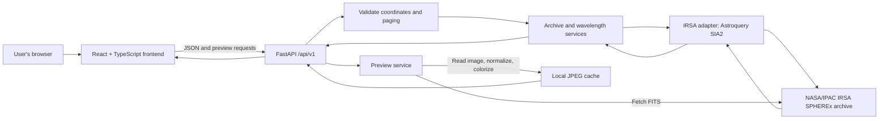

# Cosmic Eye

Cosmic Eye is a browser-based explorer for public **SPHEREx** infrared observations. It helps people search the sky by coordinates or an astronomical object name, view FITS-derived image previews, and explore available wavelengths from the NASA/IPAC Infrared Science Archive (IRSA).

Built as a team prototype for the **2026 NASA Space Apps Challenge — “Planet X and SPHEREx.”** Cosmic Eye is an independent project and is **not an official NASA product**. It does not discover, detect, or confirm Planet X or any other object.

> **Scope note:** Time-based image comparison and difference/candidate detection were intentionally excluded from the current product scope. This README describes the code that is present now, not every idea in the development handoffs.

## Contents

- [What you can do](#what-you-can-do)
- [What is intentionally excluded](#what-is-intentionally-excluded)
- [How it is built](#how-it-is-built)
- [Repository structure](#repository-structure)
- [Requirements](#requirements)
- [Run locally](#run-locally)
- [Configuration](#configuration)
- [API overview](#api-overview)
- [Data, visualization, and scientific limitations](#data-visualization-and-scientific-limitations)
- [Tests and checks](#tests-and-checks)
- [Troubleshooting](#troubleshooting)
- [Project documentation](#project-documentation)
- [Credits and disclaimer](#credits-and-disclaimer)

## What you can do

- **Search real archive records by sky coordinates.** The backend queries SPHEREx Quick Release 2 (collection `spherex_qr2`) through IRSA's SIA2 interface and returns normalized metadata.
- **Resolve common object names to coordinates.** The “AI Search” feature is an astronomical name lookup through SIMBAD, with a small local fallback list. It is not a generative AI assistant or unrestricted natural-language search.
- **View observations.** The backend reads FITS products and produces browser-friendly, false-color JPEG previews. The viewer supports zoom and pan and displays selected archive metadata and a link to the source product.
- **Explore available wavelength records.** The Wavelength Explorer presents unique wavelengths returned for a searched region and links them to their source products. Coverage varies by sky position and archive release.
- **Create an experimental RGB-style composite.** The True-Color page maps the shortest, middle, and longest available wavelength records to red, green, and blue for visual exploration. This is a false-color visualization, not a calibrated visible-light photograph.
- **Browse featured targets and a preset search region.** Featured home-page cards use astronomical target coordinates to start an archive query. The Browse page loads a fixed preset sky region and sorts its returned page by date; it is not a mission-wide date search. Decorative home-page background images are not SPHEREx data.

Current frontend pages are Home (`/`), AI Search (`/ai-search`), Browse (`/browse`), Manual Search (`/explore`), Wavelengths (`/wavelengths`), True Color (`/rgb`), and Learn (`/learn`). The Learn page is currently a placeholder rather than a finished educational guide.

## What is intentionally excluded

The following are **not part of the current user-facing application**:

- **Time Machine / compare-over-time workflow.** A prior comparison experiment was intentionally removed. The current app does not provide a supported two-observation comparison workflow.
- **Pixel subtraction, difference images, or candidate ranking.** The application does not identify changed pixels or rank transient candidates.
- **Planet X or discovery claims.** No output should be interpreted as evidence of a new planet, moving object, or confirmed discovery.
- **Scientifically validated AI/ML results.** The displayed classification labels come from a small XGBoost model initialized with dummy training examples; they are experimental UI labels, not validated SPHEREx science. An anomaly helper exists in the backend code but is not exposed as a user-facing feature or API endpoint.
- **A calibrated RGB product.** The RGB endpoint independently normalizes three images and crops arrays to matching dimensions; it does not perform WCS reprojection, registration, or color calibration. Treat it as an illustrative composite only.
- **A finished Learn center, accounts, user data storage, bulk downloads, or a production deployment configuration.**

These limits are deliberate. A visible difference between images or wavelengths can result from observing conditions, calibration, noise, background, detector effects, or processing—not necessarily an astrophysical event.

## How it is built

### Technology

| Layer | Technologies | Role |
|---|---|---|
| Web client | React 18, TypeScript, Vite, React Router | Pages, search forms, result cards, viewers, wavelength controls |
| API | Python 3.11, FastAPI, Pydantic | Input validation, JSON endpoints, API documentation |
| Archive access | Astroquery, PyVO, NASA/IPAC IRSA SIA2 | Search public SPHEREx archive records |
| Science/image handling | Astropy, NumPy, Matplotlib, Pillow | FITS reading, display normalization, and JPEG previews |
| Preview cache | Local disk under `backend/tmp/previews/` | Reuse generated previews between requests |
| Quality checks | pytest, Ruff, TypeScript compiler | Backend tests/lint and frontend type checking |

### Architecture and request flow



### Main responsibilities

- **Frontend (`frontend/src`)** owns navigation, search flows, result presentation, preview viewing, and wavelength/RGB controls. It talks to the backend API rather than querying IRSA directly.
- **API routes (`backend/app/api`)** expose health and observation-related endpoints.
- **IRSA adapter (`backend/app/adapters/irsa_spherex.py`)** encapsulates archive queries.
- **Archive service (`backend/app/services/archive_service.py`)** filters to calibrated image products, normalizes archive fields and wavelength units, and assembles observation/wavelength responses.
- **Preview service (`backend/app/services/preview_service.py`)** downloads FITS files, reads the science image and (when present) the ZODI extension, applies display normalization and a `magma` colormap for single-band previews, then caches JPEG output locally.
- **Schemas and utilities (`backend/app/schemas`, `backend/app/utils`)** define response models, input limits, and error handling.

## Repository structure

This tree reflects the current repository; it does not include planned-but-unimplemented architecture files.

```text
cosmic-eye/
├── README.md
├── LICENSE
├── nano                         # HTML entry document loaded by Vite
├── run.sh                       # start backend and frontend (Bash)
├── scripts/
│   ├── dev.sh                   # start both development servers
│   └── check.sh                 # backend lint/tests + frontend typecheck
├── docs/
│   ├── api_contract.md
│   ├── data_provenance.md
│   ├── demo_script.md
│   ├── deployment.md
│   ├── product_requirements.md
│   ├── science_and_limitations.md
│   └── testing_plan.md
├── handoffs/                    # staged development notes and decisions
├── backend/
│   ├── pyproject.toml
│   ├── requirements.txt
│   ├── stage0_explore.py         # data-access investigation, not app runtime
│   ├── stage0_inspect.py         # FITS investigation, not app runtime
│   ├── app/
│   │   ├── main.py              # FastAPI application and middleware
│   │   ├── config.py
│   │   ├── adapters/            # IRSA integration
│   │   ├── api/                 # health and observation routes
│   │   ├── schemas/             # Pydantic API models
│   │   ├── services/            # archive, preview, AI lookup, ML, etc.
│   │   └── utils/               # limits and error handling
│   ├── tests/                   # backend pytest suite
│   ├── stage0_output/           # recorded Stage 0 evidence/provenance
│   └── tmp/previews/            # generated cache; ignored by Git
├── frontend/
│   ├── package.json
│   ├── package-lock.json
│   └── src/
│       ├── App.tsx              # route table
│       ├── api/                 # typed API clients
│       ├── components/          # viewer, cards, navigation, UI states
│       ├── routes/              # page components
│       ├── styles/              # global styles and design tokens
│       ├── types/               # API data types
│       └── utils/               # formatting and validation helpers
└── tests/
	├── e2e/                     # critical journey notes
	└── fixtures/                # small metadata fixture/documentation
```

## Requirements

- **Python 3.11** (the backend package declares `>=3.11,<3.12`)
- **Node.js 20 or 22** and npm
- Git
- Internet access for IRSA/SIMBAD requests and first-time FITS preview downloads

The application is a web app: end users need a browser and network access, not Python or Node.js. The commands below are for development. The convenience shell scripts require Bash (Linux/macOS, or a compatible shell on Windows); manual commands can be run in separate terminals on other platforms.

## Run locally

### 1. Set up and start the backend

From the repository root:

```bash
cd backend
python3.11 -m venv .venv
source .venv/bin/activate
python -m pip install --upgrade pip
pip install -r requirements.txt
uvicorn app.main:app --reload --port 8000
```

The API is available at `http://localhost:8000`. Interactive OpenAPI documentation is at `http://localhost:8000/docs`; the health check is at `http://localhost:8000/api/v1/health`.

**Windows PowerShell:** create the environment with `py -3.11 -m venv .venv`, activate it with `.venv\\Scripts\\Activate.ps1`, then use the same pip and Uvicorn commands.

### 2. Set up and start the frontend

Open a second terminal at the repository root:

```bash
cd frontend
npm ci
npm run dev
```

Open the local URL printed by Vite (normally `http://localhost:5173`). Vite proxies `/api` requests to the backend at `http://localhost:8000` during development.

### Start both with a script

After setting up the Python environment and installing frontend packages, run from the repository root:

```bash
./run.sh
```

This Bash helper starts both servers and stops them when interrupted. `./scripts/dev.sh` provides the same development workflow. Manual startup above is recommended when using Windows or troubleshooting either service.

## Configuration

Backend settings are loaded from environment variables and an optional `backend/.env` file. The root [.env.example](.env.example) documents the currently declared settings. To use it as a starting point, copy it to `backend/.env`; do not commit local environment files or secrets.

| Setting | Default | Purpose |
|---|---|---|
| `IRSA_BASE_URL` | `https://irsa.ipac.caltech.edu` | Declared archive base URL setting |
| `FRONTEND_ORIGIN` | `http://localhost:5173` | Allowed CORS origin for the API |
| `CACHE_TTL_SECONDS` | `300` | Declared cache setting |
| `MAX_RESULTS` | `50` | Declared result limit setting |
| `MAX_DOWNLOAD_BYTES` | `50000000` | Declared download limit setting |
| `REQUEST_TIMEOUT_SECONDS` | `30` | Declared request timeout setting |

The current preview cache directory defaults to `backend/tmp/previews/`. Local preview URLs in some frontend components currently point directly to `http://localhost:8000`; a deployed frontend therefore needs configuration/code changes before it can be considered production-ready. No IRSA API key is configured by this project.

## API overview

API prefix: `/api/v1`. The exact schemas are defined in `backend/app/schemas/`; the live OpenAPI specification is available at `/docs` while the backend is running.

| Method | Endpoint | Description |
|---|---|---|
| `GET` | `/api/v1/health` | API liveness, service name, and version |
| `GET` | `/api/v1/observations` | Search observations. Required: `ra`, `dec`; optional: `radius` (default `0.01` degrees), `collection` (default `spherex_qr2`), `page` (default `1`), `page_size` (default `10`). |
| `GET` | `/api/v1/observations/wavelengths` | Return wavelength records and grouped multi-band sets for `ra`, `dec`, optional `radius`, and `collection`. |
| `GET` | `/api/v1/observations/featured` | Return the static featured-target list used on Home. |
| `GET` | `/api/v1/observations/ai-search?q=...` | Resolve an object name through SIMBAD, then return coordinates. |
| `GET` | `/api/v1/observations/random` | Generate random sky coordinates. |
| `GET` | `/api/v1/observations/preview?url=...` | Create or retrieve a single-band JPEG preview for an allowed IRSA product URL. |
| `GET` | `/api/v1/observations/preview/rgb?url1=...&url2=...&url3=...` | Create or retrieve an experimental three-band composite from allowed IRSA product URLs. |

Coordinate searches are bounded: RA must be in $[0, 360]$, Dec in $[-90, 90]$, radius must be greater than zero and no more than 1 degree, and page size is limited to 50. There is **no current compare/difference API endpoint**.

## Data, visualization, and scientific limitations

- Archive records come from public SPHEREx products queried via NASA/IPAC IRSA SIA2. The backend filters to calibrated (`calib_level >= 2`) image records before returning observations.
- Product coverage, metadata, and response times depend on the archive and the searched sky coordinates. An empty result does not mean that a sky region has no astronomical objects.
- A single-band preview is a display rendering, not the underlying science array: the service uses Astropy normalization and a `magma` colormap and may subtract the product's ZODI model extension when present. The original FITS product remains linked from observation details.
- The first preview request downloads and processes the source FITS product. Some products are large (a Stage 0 verified example was about 71 MB), so first-load delays depend on the network and archive. Generated previews are cached on local disk; the cache is not a persistent scientific archive.
- The wavelength page aggregates records returned for the search region; entries can come from different overlapping scans. A slider across those records should not be interpreted as a calibrated spectrum of one object.
- The RGB-style image is made for visual exploration only. The current implementation does not align/reproject bands to a common WCS grid or calibrate colors.
- The ML-derived classification labels are produced by a model trained on tiny dummy examples for the prototype. They are not scientifically validated and must not be treated as physical classifications or confidence estimates.
- SIMBAD lookup resolves astronomical names to coordinates; it does not understand arbitrary questions. A small fallback name list may be used when the lookup service is unavailable.
- Featured-target card imagery on the Home page is decorative remote imagery. It is not an IRSA product; selecting a target starts a separate archive search using its coordinates.

For details on verified sample data and FITS structure, see [docs/data_provenance.md](docs/data_provenance.md) and [docs/science_and_limitations.md](docs/science_and_limitations.md).

## Tests and checks

From the repository root, after completing local setup:

```bash
./scripts/check.sh
```

The script runs Ruff and pytest in the backend, then the frontend TypeScript type check. You can also run these independently:

```bash
cd backend
ruff check app tests
pytest -q
```

```bash
cd frontend
npm run typecheck
npm run build
```

There is no frontend unit-test command configured in `package.json` at this time. Backend tests live in `backend/tests/`; browser journey notes and fixtures are under the root `tests/` directory.

## Troubleshooting

- **Frontend loads but API calls fail:** confirm Uvicorn is running on port 8000 and Vite is on port 5173. Check `http://localhost:8000/api/v1/health`.
- **Archive request fails or hangs:** IRSA is an upstream service. Retry later or try another coordinate; the application depends on network access and current archive availability.
- **Preview is slow:** the first request downloads a FITS product and generates a JPEG. Later requests can use the local disk cache. To clear generated previews, stop the backend and remove files under `backend/tmp/previews/`.
- **Python import error on a clean environment:** install dependencies from `backend/requirements.txt` inside the activated Python 3.11 virtual environment.
- **Shell script does not run:** scripts use Bash and expect `backend/.venv` and `frontend/node_modules` to have been created first. Follow the manual two-terminal setup instead.

## Project documentation

- [Data provenance](docs/data_provenance.md) — verified Stage 0 archive query and FITS-product notes.
- [Science and limitations](docs/science_and_limitations.md) — scientific cautions and open data questions.
- [Architecture handoff](handoffs/architecture_handoff.md) — original proposal and staged architecture context; some planned features were later excluded.
- [Stage 6 handoff](handoffs/stage6_handoff.md) — wavelength explorer implementation and explicit note that Stage 5 time-difference analysis was removed.
- [Stage 9 handoff](handoffs/stage9_handoff.md) — stability and wavelength aggregation notes.

Some files in `docs/` (including the API contract, product requirements, deployment guide, demo script, and testing plan) are currently empty placeholders. The running API's OpenAPI page is the source of truth for implemented endpoints.

## Credits and disclaimer

Cosmic Eye is an independent, team-built prototype for the NASA Space Apps Challenge. SPHEREx data access is provided through NASA/IPAC IRSA and the public archive. The project is not affiliated with or endorsed by NASA, JPL, Caltech, or the SPHEREx mission team. Follow the archive's current data-use and attribution guidance when reusing products.

This application is for public exploration and demonstration, not validated scientific analysis. A visual feature or model label is not a discovery. Always consult the original data, provenance, product documentation, and appropriate scientific expertise before drawing conclusions.
