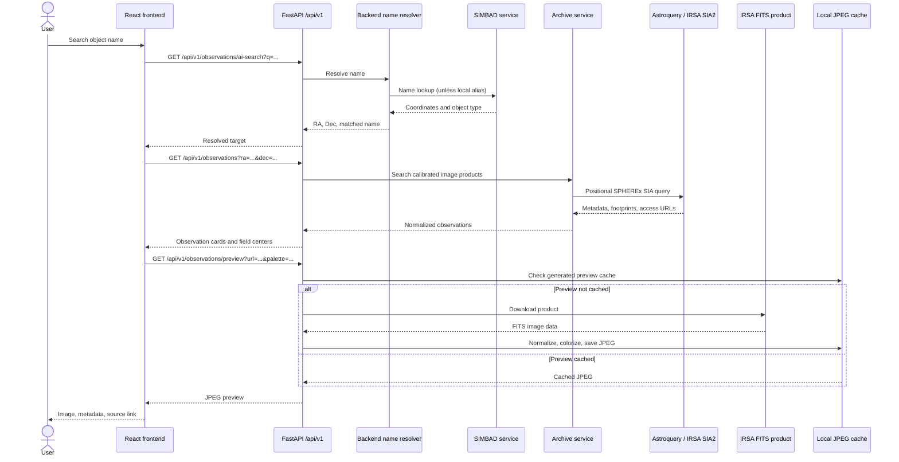

# Cosmic Eye

Cosmic Eye is a web app for exploring public NASA SPHEREx infrared observations. Search by sky coordinates or astronomical object name, browse regions with archive coverage, view image previews, and inspect the same sky area across available infrared bands.

The project was built for the 2026 NASA Space Apps Challenge. It is an independent prototype, not an official NASA product, and it does not detect or confirm Planet X or any other discovery.

## Contents

- [Features](#features)
- [End-to-end architecture](#end-to-end-architecture)
- [Science and data limits](#science-and-data-limits)
- [Technology](#technology)
- [Run locally](#run-locally)
- [Configuration](#configuration)
- [API](#api)
- [Project structure](#project-structure)
- [Checks](#checks)
- [License and attribution](#license-and-attribution)

## Features

| Feature | What it does | Data and behavior |
| --- | --- | --- |
| Home (`/`) | Introduces Cosmic Eye and links to search, browse, and featured targets. | Featured thumbnails can be decorative external images; selecting a target starts an archive search at its coordinates. |
| AI Search (`/ai-search`) | Resolves an astronomical object name and finds SPHEREx products near its position. | Uses SIMBAD plus a small local alias list. “AI” is the product label; this is name resolution, not a generative assistant. |
| Manual Search (`/explore`) | Searches by right ascension and declination; opens observation metadata and source links. | Results are image footprints around the searched position. Displayed RA/Dec values are the product field centers. |
| Browse (`/browse`) | Offers Popular Regions and Recent Observations tabs. | Region cards load real SPHEREx previews. Recent Observations queries a fixed sample sky field, not a mission-wide date search. |
| Popular Regions (`/popular-regions`) | Opens Browse at its region tab. | Uses a curated target catalog; selecting a card opens that target’s archive observations. |
| Sky Map (`/skymap`) | Interactive Three.js sky sphere with rotation, zoom, grid, filters, target selection, and name search. | Displays 117 built-in target records and Hipparcos guide stars. Added targets are checked for archive coverage and saved in browser local storage. It is not a complete map of all observations. |
| Color Lab (`/rgb`) | Changes the display palette or wavelength band for an infrared image; includes a queue of scans in the region. | Displays one band image at a time. Palettes: Inferno, Viridis, Plasma, Cividis, and Magma. |
| Learn (`/learn`) | Explains infrared and how wavelength/palette choices affect display. | Includes an illustrative signal graphic, not observed SPHEREx data. |

## End-to-end architecture

This sequence shows an object-name search through to the rendered image. Coordinate search skips name resolution; Sky Map and Color Lab use the same archive and preview API through their own controls.



### Component responsibilities

| Component | Responsibility |
| --- | --- |
| React pages and components (`frontend/src/`) | Search forms, navigation, result cards, metadata viewer, Color Lab controls, and 3D sky view. |
| Typed API clients (`frontend/src/api/`) | Build `/api/v1` requests and preview URLs. |
| FastAPI routes (`backend/app/api/`) | Validate and route observation, name-resolution, catalog, and preview requests. |
| Archive service (`backend/app/services/archive_service.py`) | Filter calibrated image products, normalize wavelength units and timestamps, and group available bands. |
| IRSA adapter (`backend/app/adapters/irsa_spherex.py`) | Query SPHEREx image coverage through Astroquery’s SIA interface. |
| Name resolver (`backend/app/services/ai_service.py`) | Resolve local aliases or query SIMBAD for target coordinates. |
| Preview service (`backend/app/services/preview_service.py`) | Download FITS, normalize science pixels, apply a display palette, and cache JPEG previews. |
| External services | NASA/IPAC IRSA supplies SPHEREx products; SIMBAD resolves astronomical names. |

Single-band previews are display renderings, not the underlying science arrays. Palette colors encode signal and do not show true visible-light colors. The optional backend RGB-preview endpoint combines three files for illustration; it does not perform WCS registration/reprojection or photometric color calibration.

### Science and data limits

- A search result’s RA and Dec are the image tile’s center. A tile can cover the requested target even when its center is some distance away. The preview can show a wide field rather than a close-up of the target.
- IRSA results and available bands depend on the archive release and sky position. An empty result means no matching product was returned for that query; it does not mean there are no astronomical objects there.
- The Color Lab queue groups archive records by observation ID. Bands may come from overlapping scans, and comparing them is not a calibrated spectrum.
- The Sky Map plots catalog directions on a sphere centered at the SPHEREx observer viewpoint. Marker locations encode RA/Dec direction, not physical distance or object size. The background stars come from a bundled Hipparcos coordinate list; target markers represent catalog entries with recorded SPHEREx coverage.
- Observation wavelength labels describe the band. They do not identify the contents of an image. Do not interpret UI labels as scientific classifications or detections.
- Archive files and externally hosted imagery retain their own source terms and attribution requirements. The repository’s MIT license does not relicense them.

## Technology

| Area | Stack |
| --- | --- |
| Frontend | React 18, TypeScript, Vite, React Router, Three.js |
| Backend | Python 3.11, FastAPI, Pydantic |
| Archive and coordinates | Astroquery, Astropy, PyVO, NASA/IPAC IRSA, SIMBAD |
| FITS previews | Astropy, NumPy, Matplotlib, Pillow |
| Checks | pytest, Ruff, TypeScript compiler |

## Run locally

You need Python 3.11, Node.js/npm, Git, and internet access to reach IRSA and SIMBAD. From the repository root, create and start the backend:

```bash
cd backend
python3.11 -m venv .venv
source .venv/bin/activate
python -m pip install --upgrade pip
pip install -r requirements.txt
uvicorn app.main:app --reload --port 8000
```

In a second terminal, start the frontend:

```bash
cd frontend
npm ci
npm run dev
```

Open the local URL printed by Vite (normally `http://localhost:5173`). The Vite development server proxies `/api` to the backend at `http://localhost:8000`. Alternatively, after installing both sets of dependencies, run `./run.sh` from the repository root. The helper scripts use Bash.

The API health check is at `http://localhost:8000/api/v1/health`; interactive API documentation is at `http://localhost:8000/docs`.

## Configuration

The backend can read an optional `backend/.env` file. `.env.example` lists the declared environment settings. `FRONTEND_ORIGIN` controls the CORS allowlist; the preview cache defaults to `backend/tmp/previews/`. Some other example settings are declared in configuration but are not currently used to control every upstream request or cache behavior. The app does not require an IRSA API key.

The frontend accepts `VITE_API_BASE_URL` for an API base URL; when unset it uses relative `/api` URLs, which work with the local Vite proxy. Local preview generation requires the backend to be reachable.

## API

All routes are under `/api/v1`:

| Method | Endpoint | Purpose |
| --- | --- | --- |
| `GET` | `/health` | Liveness and service version. |
| `GET` | `/observations?ra=…&dec=…` | Search calibrated SPHEREx image products near a coordinate. Optional parameters: `radius` (default `0.01°`, maximum `1°`), `collection` (default `spherex_qr2`), `page` (default `1`), and `page_size` (default `10`, maximum `50`). |
| `GET` | `/observations/wavelengths?ra=…&dec=…` | Return available wavelength records and multi-band observation groups. Used by Color Lab. |
| `GET` | `/observations/featured` | Return the built-in featured target catalog. |
| `GET` | `/observations/ai-search?q=…` | Resolve an object name and return its coordinates. |
| `GET` | `/observations/random` | Return a random sky coordinate. |
| `GET` | `/observations/preview?url=…&palette=…` | Return a cached or newly generated single-band JPEG preview. |
| `GET` | `/observations/preview/rgb?url1=…&url2=…&url3=…` | Return an experimental three-band composite. |

Coordinates and search bounds are validated by the backend. The live OpenAPI documentation at `/docs` is the reference for request and response schemas.

## Project structure

```text
cosmic-eye/
├── README.md                         Setup, features, architecture, and limits
├── LICENSE                           MIT license for project source
├── .env.example                      Backend environment examples
├── run.sh                            Starts backend and frontend (Bash)
├── scripts/
│   ├── dev.sh                        Development server launcher
│   └── check.sh                      Ruff, pytest, and TypeScript checks
├── backend/
│   ├── app/
│   │   ├── main.py                   FastAPI application and middleware
│   │   ├── config.py                 Backend settings
│   │   ├── api/                      Health and observation HTTP routes
│   │   ├── adapters/                 NASA/IPAC IRSA access
│   │   ├── services/                 Archive, name resolution, FITS preview services
│   │   ├── schemas/                  Pydantic API response models
│   │   ├── utils/                    Coordinate validation and error handling
│   │   └── catalogs/                 Bundled Messier target records
│   ├── tests/                        Backend pytest suite
│   ├── requirements.txt              Python dependencies
│   └── pyproject.toml                Python and tool configuration
├── frontend/
│   ├── index.html                    Vite HTML entry
│   ├── package.json                  Frontend scripts and dependencies
│   ├── vite.config.ts                Development server and API proxy
│   └── src/
│       ├── main.tsx                  React entry point and global styles
│       ├── App.tsx                   Layout and route table
│       ├── api/                      Typed API clients and URL builders
│       ├── routes/                   Routed page implementations
│       ├── components/               Shared UI, viewers, cards, and sky map
│       ├── catalogs/                 Hipparcos star coordinates for the map
│       ├── styles/                   Design tokens and global CSS
│       ├── types/                    Shared frontend/API types
│       └── utils/                    Formatting and input validation helpers
├── docs/
│   ├── data_provenance.md            Archive sample and data provenance notes
│   └── science_and_limitations.md    Interpretation and science cautions
└── handoffs/
    ├── handoff_updated.md            Current implementation handoff
    └── …                             Earlier staged project notes
```

Generated files and local environments such as `frontend/node_modules/`, `frontend/dist/`, `backend/.venv/`, and `backend/tmp/previews/` are local build/runtime artifacts and are not part of the application source tree.

## Checks

Run the configured checks from the repository root after setting up dependencies:

```bash
./scripts/check.sh
```

The script runs Ruff and pytest in the backend virtual environment, then the frontend TypeScript type check. To also create a production frontend bundle, run `cd frontend && npm run build`.

## License and attribution

The project source code is licensed under the MIT License; see [LICENSE](LICENSE). NASA/IPAC IRSA data products, SIMBAD data, bundled astronomical catalogs, and third-party imagery are not relicensed by that file. Follow the applicable source terms and attribution guidance when reusing them. Cosmic Eye is not affiliated with or endorsed by NASA, JPL, Caltech, or the SPHEREx mission team.

For implementation details and verified data notes, see [handoffs/handoff_updated.md](handoffs/handoff_updated.md) and [docs/data_provenance.md](docs/data_provenance.md).
